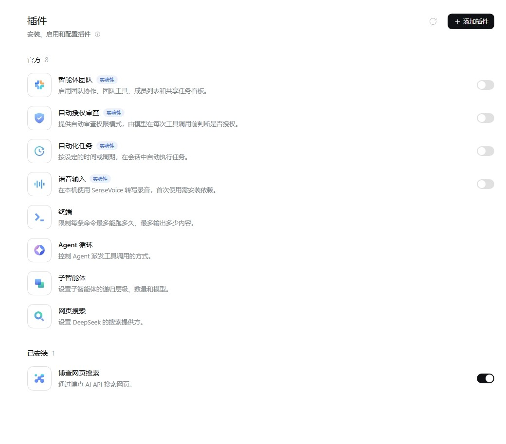
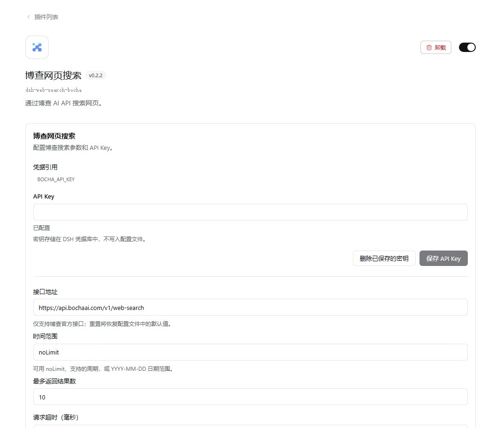
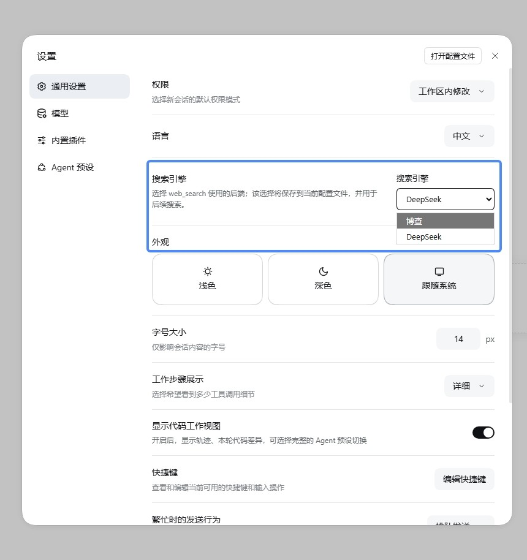

# 博查网页搜索 for DSH

[简体中文](README.md) | [English](README.en.md)

这是一个面向 DeepSeek Harness（DSH）的 Cordis bundle，为 DSH 的 `ctx.web` 提供网页搜索。当前版本为 **0.2.2**，面向 DSH `0.2.0-rc.2` 和 Cordis `~4.0.4`。

## 功能

- 将固定的 DSH 网页搜索 provider `bocha` 路由到博查或 DSH 官方 DeepSeek 搜索 provider。
- 可在 DSH 设置中选择搜索引擎；新安装默认使用 Bocha，选择会保存到当前 Profile。
- 成功结果会标注实际使用的厂商：`Search provider: Bocha (bocha).` 或 `Search provider: DeepSeek (deepseek-official).`
- 可直接在 **博查网页搜索** bundle 详情页配置 Bocha API Key 和搜索参数，无需再进入单独的插件行配置页。
- API Key 通过 DSH 凭据服务保存，不写入 Profile 配置文件。
- 复用 DSH 自带的 DeepSeek 搜索 provider；不会停用官方 DeepSeek 插件。

## 安装与首次使用

本插件是 DSH bundle（目标版本：DSH `0.2.0-rc.2`、Cordis `~4.0.4`）；请先安装 DSH CLI。包发布到 npm 后，在终端中安装到要运行 DSH 的 Profile：

```sh
dsh plugin --profile my-profile add dsh-bocha-web-search-plugin
```

将 `my-profile` 替换为你使用的 Profile 名称。此命令会从 npm 安装包并将 bundle 加入该 Profile；单独在任意项目中运行 `npm install` 不会把插件注册到 DSH。命令说明见 [DSH 官方安装插件指南](https://deepseek-harness.github.io/deepseek-harness/develop/basic/publish)。

安装后按以下步骤首次使用：

1. 使用同一个 Profile 启动或重启 DSH Web UI，在 **插件** 页面确认 **博查网页搜索** 已启用。
2. 在 bundle 详情页保存 Bocha API Key（详细配置见下节）；可从[博查开放平台](https://open.bochaai.com/)获取密钥。密钥保存在 DSH 凭据库中。
3. 前往 **设置 → 通用设置 → 搜索引擎**，选择 **Bocha**。
4. 在新会话中试试“搜索今天的 AI 新闻并列出来源”，确认结果中出现 `Search provider: Bocha (bocha).`。

插件启用后的列表页面示例：



## 配置 Bocha

1. 在插件列表中打开 **博查网页搜索** bundle。
2. 在详情页填写并保存 Bocha API Key。密钥保存在 DSH 凭据库中，不会写入配置文件。
3. 按需调整接口地址、时间范围、最多返回结果数和请求超时。

详情页配置示例：



默认 Bocha 参数：

| 参数 | 默认值 | 说明 |
| --- | --- | --- |
| API Key 引用 | `BOCHA_API_KEY` | 通过 DSH 凭据服务解析 |
| 接口地址 | `https://api.bochaai.com/v1/web-search` | Bocha Web Search API |
| 时间范围 | `noLimit` | 不限制时间范围；也可使用接口支持的日期范围 |
| 最多返回结果数 | `10` | 每次搜索的结果上限 |
| 请求超时 | `15000` ms | Bocha 搜索请求超时 |

## 使用 DeepSeek 搜索

在 DSH 设置中将搜索引擎切换为 **DeepSeek**，即可通过 DSH 自带的 DeepSeek 搜索 provider 搜索。该路由使用 DSH 标准 `DEEPSEEK_API_KEY` 凭据引用、账号令牌路径及可选的 `DEEPSEEK_SEARCH_BASE_URL` 启动环境变量。请保持 DSH 自带的 DeepSeek 搜索插件启用；本插件不会同步该插件独立配置行中的自定义参数。

可在 **设置 → 通用设置 → 搜索引擎** 中切换 Bocha 和 DeepSeek：



## 结果标记

模型调用 DSH 的 `web_search` 工具时，成功的搜索结果会在 `Sources:` 前包含实际搜索厂商标记。例如：

```text
Search provider: Bocha (bocha).
```

或：

```text
Search provider: DeepSeek (deepseek-official).
```

该标记用于区分本次请求实际走过的搜索路由，不改变 DSH 的 `web_search` 工具名或来源列表格式。

## 路线图 / TODO

- [ ] 按[博查官方 API 文档](https://aq6ky2b8nql.feishu.cn/wiki/HmtOw1z6vik14Fkdu5uc9VaInBb)扩展支持完整搜索能力：
  - **Web Search API (`bocha-web-search`)**：自然语言查询、时间/站点过滤和文本摘要；返回网页标题、链接、片段、摘要、站点信息、发布时间及图片，开放平台总览也列出视频搜索。
  - **AI Search API (`bocha-ai-search`)**：通过 `answer` / `stream` 控制大模型总结和流式输出；除网页、图片外，还返回天气、百科、医疗、火车、汇率、股票等垂直领域模态卡及追问。
  - **Agent Search API (`bocha-agent-search`)**：调用专业领域智能体回答问题并提供深入结果与追问。
  - **Semantic Reranker API**：按语义相关性排序文档并返回得分。
- [ ] 为各 API 增加独立配置、凭据管理、路由、结果标准化和测试；实现前核对登录后文档中的参数、权限和计费规则。
- 当前插件仅接入 Web Search API；AI Search、Agent Search 和 Semantic Reranker 尚未实现。

## 搜索及相关 API 价格对比（统一口径）

> 统一按 **人民币（CNY）/1,000 次 API 调用**均摊；价格快照：**2026-10-11**。美元报价按 2026-10-09 人民币中间价 **1 USD = ¥6.7330** 换算并四舍五入到分（[汇率来源](https://www.sohu.com/a/1086126179_122014422)）。套餐、峰谷或搜索深度不同的，以价格范围表示。

| API | 折算价格（CNY / 1,000 次调用） | 口径说明 |
| --- | ---: | --- |
| **Bocha Web Search** | **¥3.60–¥36** | 付费资源包均摊价；按量 ¥36/千次，另有 1,000 次免费试用（3 个月）。大额包降至 ¥32/¥30/¥28/¥25 每千次。[博查价目页](https://aq6ky2b8nql.feishu.cn/wiki/JYSbwzdPIiFnz4kDYPXcHSDrnZb) |
| **Bocha AI Search** | **¥60** | 按量 ¥0.060/次；已列资源包均为 ¥60/千次、有效期 1 年。[博查价目页](https://aq6ky2b8nql.feishu.cn/wiki/JYSbwzdPIiFnz4kDYPXcHSDrnZb) |
| **Bocha GTE Reranker** | **¥5** | `gte-rerank` ¥0.005/次，自 2025-11-01 起计费；这是重排调用，不是搜索请求。[博查价目页](https://aq6ky2b8nql.feishu.cn/wiki/JYSbwzdPIiFnz4kDYPXcHSDrnZb) |
| **DeepSeek 原生搜索（估算）** | **¥5.05–¥10.10** | 假设每次搜索 1,000 输入 tokens（缓存未命中）+ 1,000 输出 tokens；范围对应低峰/高峰 API Key 价格。实际费用随 token 用量变化。[官方价格](https://api-docs.deepseek.com/quick_start/pricing) |
| **Brave Search** | **¥33.67** | 固定价 $5/1,000 次请求，按上述汇率换算；另有每月 $5 credits。[官方价格](https://brave.com/search/api/) |
| **Tavily Search** | **¥53.86–¥107.73** | 按量价范围：Basic 1 credit、Advanced 2 credits，$0.008/credit；月付计划约 ¥33.67–¥50.50（Basic）、¥67.33–¥101.00（Advanced），免费档每月 1,000 credits。[计费规则](https://docs.tavily.com/documentation/api-credits.md)、[官方价格](https://www.tavily.com/pricing) |

价格可能调整，购买前请以[博查价目页](https://aq6ky2b8nql.feishu.cn/wiki/JYSbwzdPIiFnz4kDYPXcHSDrnZb)及各供应商官方页面为准。

## 开发与测试

```sh
npm install
npm test
```

`npm test` 会构建浏览器端模块、检查 JavaScript 语法，并运行 provider 路由、凭据解析及响应处理测试。测试使用受控响应，不会代替真实 API 联网验证。

- [生产配置补丁示例](cordis.patch.yml)
- [独立组合配置示例](composition.example.yml)
- `src/index.js`、`src/provider.js`：Host provider 与路由实现
- `src/client.js`：设置与 bundle 配置 UI
- `docs/`：插件启用和配置截图

## 项目声明、开源协议与致谢

本仓库由个人开发者独立开发和维护，不是博查（Bocha AI）、DeepSeek 或 DSH 官方项目。选择 Bocha 时，搜索请求发送到博查提供的 API；实际使用须遵守博查的服务条款、隐私政策和配额限制。本仓库代码采用 MIT License（见 [package.json](package.json) 中的 `license` 字段）。博查、DeepSeek 和 DSH 的名称及商标归各自权利人所有。

感谢 **DeepSeek Harness（DSH）** 提供插件运行与 Web 搜索扩展能力，也感谢 **Bocha** 提供搜索服务与 API。
